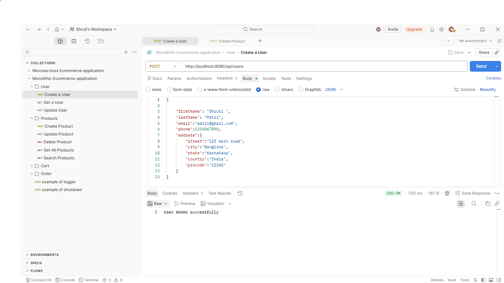
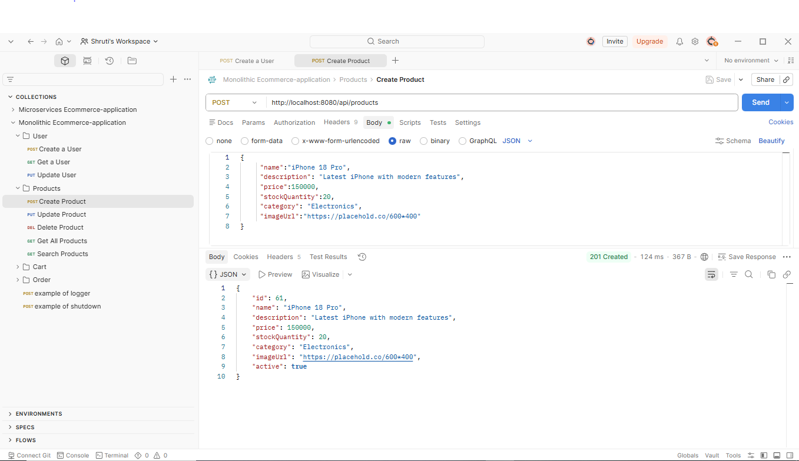
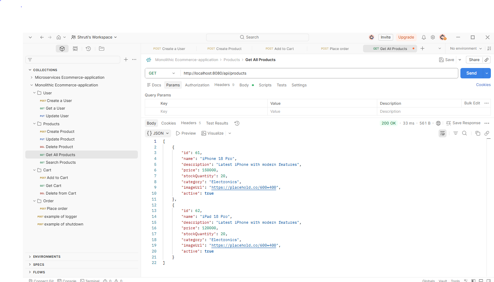
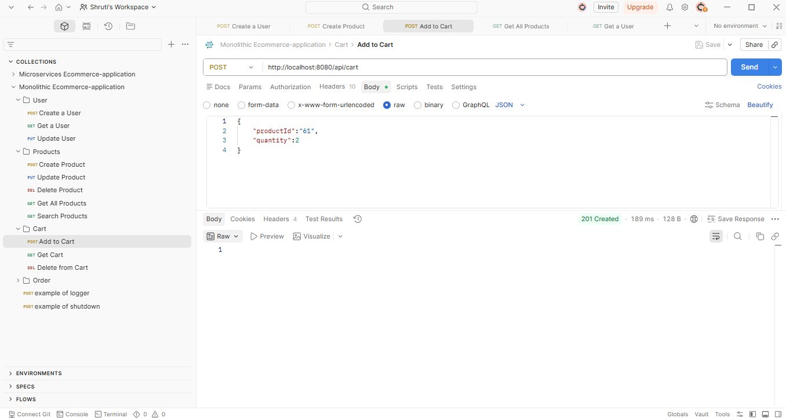
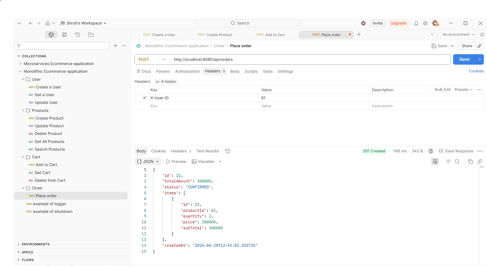

# Monolithic E-Commerce Application

A Spring Boot–based monolithic e-commerce backend with **Users, Products, Cart, and Orders** built on a clean **Controller → Service → Repository → Entity** layered architecture, backed by Oracle 21c.

This project was later evolved into a **microservices version** (separate User, Product, and Order services) as part of a monolith → microservices migration learning exercise.

---

## 🛠️ Tech Stack

| Layer | Technology |
|---|---|
| Language | Java 17 |
| Framework | Spring Boot 3.4.3 |
| Persistence | Spring Data JPA / Hibernate |
| Database | Oracle 21c (XE), driver: `ojdbc11` |
| Build Tool | Maven |
| Boilerplate | Lombok |
| Monitoring | Spring Boot Actuator (`/actuator/health`, `/actuator/info`) |
| Containerization | Docker (Dockerfile + Spring Boot Buildpacks image) |

---

## 🏗️ Architecture

Layered Architecture — **Controller → Service → Repository → Entity**:

```
src/main/java/com/ecom/app
├── EcommerceApplication.java
├── controller/      → REST endpoints (CartItem, Order, Product, User)
├── dto/             → Request/Response objects (decouples API from entities)
├── entity/          → JPA entities (Address, CartItem, Order, OrderItem, Product, User + enums)
├── repository/      → Spring Data JPA repositories
└── service/         → Business logic
```

---

## 📡 API Endpoints

### User APIs — `/api/users`
| Method | Endpoint | Description |
|---|---|---|
| GET | `/api/users` | Get all users |
| GET | `/api/users/{id}` | Get user by ID |
| POST | `/api/users` | Create a new user (with optional address) |
| PUT | `/api/users/{id}` | Update user details |

### Product APIs — `/api/products`
| Method | Endpoint | Description |
|---|---|---|
| POST | `/api/products` | Create a new product |
| GET | `/api/products` | Get all active products |
| PUT | `/api/products/{id}` | Update a product |
| DELETE | `/api/products/{id}` | Soft-delete a product (sets `active = false`) |
| GET | `/api/products/search?keyword=xyz` | Search active, in-stock products by name |

### Cart APIs — `/api/cart` *(requires `X-User-ID` header)*
| Method | Endpoint | Description |
|---|---|---|
| POST | `/api/cart` | Add a product to cart (recalculates price × quantity) |
| GET | `/api/cart` | View current cart |
| DELETE | `/api/cart/items/{productId}` | Remove an item from cart |

### Order APIs — `/api/orders` *(requires `X-User-ID` header)*
| Method | Endpoint | Description |
|---|---|---|
| POST | `/api/orders` | Create an order from the current cart, then clear the cart |

---

## ⚙️ Setup & Run Locally

### 1. Prerequisites
- Java 17+
- Maven (or use included `mvnw`)
- Oracle 21c XE running on `localhost:1521`, service name `XEPDB1`

### 2. Database Setup
```sql
-- create schema/user (run as SYSTEM)
CREATE USER ecommerce_user IDENTIFIED BY "your_password";
GRANT CONNECT, RESOURCE, DBA TO ecommerce_user;
```
Then run [`schema.sql`](./schema.sql) to create tables (optional — Hibernate also auto-creates/updates tables via `ddl-auto=update`).

### 3. Set the DB password as an environment variable
The password is **not hardcoded** — it's read from an environment variable:
```
set DB_PASSWORD=your_password      (Windows cmd)
export DB_PASSWORD=your_password   (Linux/Mac)
```

### 4. Run the application
```
mvnw spring-boot:run
```
App starts on `http://localhost:8080`

### 5. (Optional) Run with Docker
```
docker build -t monolithic-ecommerce-app .
docker run -p 8080:8080 -e DB_PASSWORD=your_password monolithic-ecommerce-app
```

---

## 🔒 Security Notes

- DB password is externalized via `${DB_PASSWORD}` — never committed to source control.
- Actuator endpoints are restricted to `health` and `info` only; the `shutdown` endpoint is **disabled** to prevent unauthenticated remote shutdown of the app.
- `user_table.role` is persisted using `@Enumerated(EnumType.STRING)` (e.g. `"CUSTOMER"`, `"ADMIN"`) instead of the default ordinal/integer storage, so the meaning of a stored role can never silently shift if the enum order changes later.

---

## 🧠 Engineering Notes / Known Trade-offs

A few honest, real talking points from building and auditing this project:

- **Found and fixed a double-multiplication bug in order totals:** `CartItem.price` stores the line total (`unit price × quantity`), but `OrderService`'s response mapping was multiplying that value by quantity *again* when calculating each item's `subTotal` — silently doubling the displayed per-item total (e.g. ₹3,00,000 showed as ₹6,00,000). Traced it from the API response back through `OrderService → CartService` and fixed the mapping to stop re-multiplying an already-computed total.
- **Cart pricing is recalculated on every add** (`unit price × quantity`), unlike the microservices version of this project where `CartService.addToCart()` currently hardcodes the price — this monolithic version handles it correctly.
- **`user_table.role` was originally stored as an ordinal integer** (no `@Enumerated` annotation). Added `@Enumerated(EnumType.STRING)` and migrated the existing column/data (`NUMBER → VARCHAR2`, `0/1 → CUSTOMER/ADMIN`) so the stored value can never silently shift if the enum's declaration order changes.
- **`CartItemController.getCart()` currently returns the `CartItem` entity directly** instead of a DTO, which is inconsistent with the rest of the API (which is fully DTO-based). Planned refactor: introduce a `CartItemResponse` DTO for consistency and to avoid exposing internal entity structure.
- Products are **soft-deleted** (`active = false`) rather than physically removed, preserving order history integrity for past orders that reference them.

---

## 📸 Screenshots

| Feature | Screenshot |
|---|---|
| Create User |  |
| Create Product |  |
| Get All Products |  |
| Add to Cart |  |
| Create Order |  |

---

## 👩‍💻 Author

**Shruti Patil**
GitHub: [shrutipatil99](https://github.com/shrutipatil99)
